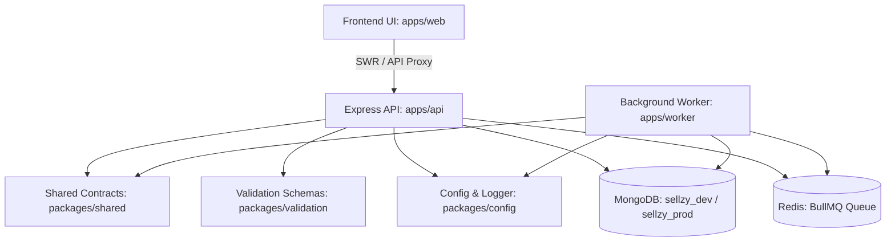

# SELLZY — MARKETING & LEAD GENERATION DEPENDENCY MAP
**Document Version:** 1.0.0  
**Date:** 2026-11-01  
**Scope:** Architecture Cross-Package Dependencies, Services, Models, and APIs  

---

## 1. System Dependency Flow



---

## 2. Model & Schema Dependencies

| Model | Schema File Location | Database Collection | Key Indexes | Consuming Services / Controllers |
| :--- | :--- | :--- | :--- | :--- |
| **`Lead`** | `apps/api/src/models/Lead.ts` | `leads` | `{ tenantId: 1, normalizedEmail: 1 }` (unique)<br>`{ tenantId: 1, verificationStatus: 1 }` | `LeadService`<br>`LeadMatchingService`<br>`LeadController` |
| **`LeadList`** | `apps/api/src/models/LeadList.ts` | `leadlists` | `{ tenantId: 1, name: 1 }` (unique) | `LeadService`<br>`LeadController` |
| **`EmailSuppression`** | `apps/api/src/models/EmailSuppression.ts` | `emailsuppressions` | `{ tenantId: 1, normalizedEmail: 1 }` (unique) | `LeadService`<br>`LeadMatchingService`<br>`LeadController` |
| **`ImportJob`** | `apps/api/src/models/ImportJob.ts` | `importjobs` | `{ tenantId: 1, createdAt: -1 }` | `LeadMatchingService`<br>`LeadController` |
| **`Campaign`** | `apps/api/src/models/Campaign.ts` | `campaigns` | `{ tenantId: 1, status: 1 }` | `CampaignService`<br>`CommunicationController`<br>`LeadController` |
| **`CampaignRecipient`**| `apps/api/src/models/CampaignRecipient.ts` | `campaignrecipients`| `{ tenantId: 1, campaignId: 1, customerId: 1 }` | `CampaignService`<br>`LeadController` |
| **`MessageTemplate`** | `apps/api/src/models/MessageTemplate.ts` | `messagetemplates` | `{ tenantId: 1, name: 1 }` (unique) | `TemplateService`<br>`CommunicationController` |
| **`Conversation`** | `apps/api/src/models/Conversation.ts` | `conversations` | `{ tenantId: 1, customerId: 1, channel: 1 }` | `ConversationService`<br>`CommunicationController` |

---

## 3. Engine Service Dependencies

```
LeadService
├── LeadDiscoveryService (Public directory & US geography search)
├── EmailVerificationService (RFC syntax, disposable domain list, DNS MX resolver)
├── EmailSuppressionModel (Persistent unsubscribe / complaint checks)
└── LeadModel & LeadListModel (Atomic persistence)

LeadMatchingService
├── EmailNormalizationService (Canonical domain & whitespace normalization)
├── SpreadsheetParserService (Formula injection sanitization, CSV streaming)
├── EmailSuppressionModel (Suppression identification)
└── LeadModel (Exact match & grabbed-only comparisons)

CampaignService
├── ConsentService (Pre-send recipient consent verification)
├── MessageService (Delivery state machine, idempotency key checks)
└── ActionRegistry / WorkflowEngine (Scheduled trigger dispatches)
```

---

## 4. Shared Package Dependencies

- `@sellzy/shared`:
  - `CANONICAL_LEAD_HEADERS`: Unified 11-column header array.
  - `LeadVerificationStatus`: 8 deliverability and verification states.
  - `MatchResultStatus`: 8 matching categories.
  - `CampaignStatus` & `CampaignRecipientStatus`.
  - `CommunicationChannel` (`EMAIL`, `WHATSAPP`, `SMS`).
- `@sellzy/validation`:
  - Customer, campaign, and communication Zod schemas.
- `@sellzy/config`:
  - Centralized environment variables (`PORT`, `MONGO_URI`, `REDIS_URI`, `JWT_SECRET`, `CORS_ORIGIN`).

